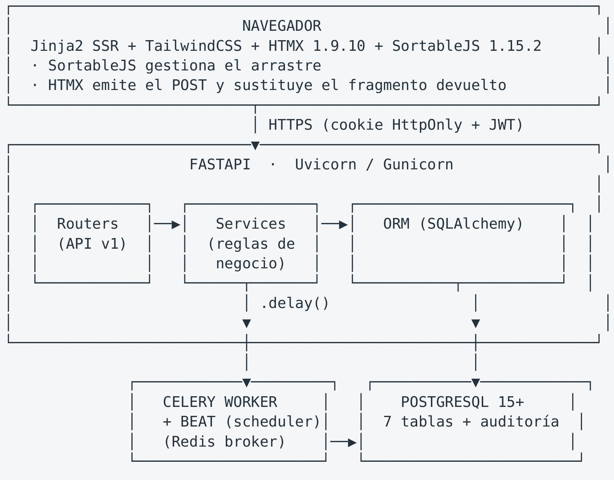

# ITSM/Kanban MVP — Descripción Técnica Completa

Documento de referencia para evaluación e incorporación del módulo a otros proyectos

Módulo de Incidencias con gestión ITSM estricta sobre visualización Kanban ágil

Versión del módulo: 0.1.0 · Fecha: 2026-10-23

### 1. Resumen ejecutivo

Este módulo implementa un Módulo de Incidencias que reconcilia dos entidades que normalmente entran en conflicto:

• La disciplina del ITSM, que exige control formal: no cualquier cambio de estado es válido, cada movimiento tiene una justificación, un actor responsable y un rastro auditable inalterable.

• La agilidad de Kanban, que exige fluidez visual: el usuario arrastra una tarjeta y espera un resultado inmediato, sin recargas de página ni fricción.

La conciliación se logra con una idea central: la interfaz es libre, el servidor es el autoridad. El tablero permite mover la tarjeta visualmente en cualquier dirección, pero el servidor valida cada movimiento contra una matriz de reglas persistida en base de datos. Si la regla no se cumple, el cambio se rechaza y la tarjeta retorna a su posición original.

El resultado es un sistema donde el compliance no se opone a la/usabilidad, sino que la habilita: el agente mueve la tarjeta con naturalidad y, si el proceso exige justificación (por ejemplo, cerrar un ticket), el sistema la exige de forma automática y la registra.

### 1.1 Métricas verificadas del código

<table><tr><td>Capa</td><td>Archivos</td><td>líneas</td></tr><tr><td>app/models/</td><td>8</td><td>476</td></tr><tr><td>app/services/</td><td>2</td><td>189</td></tr><tr><td>app/api/</td><td>7</td><td>440</td></tr><tr><td>app/core/</td><td>4</td><td>145</td></tr><tr><td>app/db/</td><td>3</td><td>254</td></tr><tr><td>app/tasks/</td><td>2</td><td>139</td></tr><tr><td>app/templates/</td><td>5</td><td>341</td></tr><tr><td>tests/</td><td>1</td><td>179</td></tr><tr><td>Total Python</td><td>—</td><td>1.708</td></tr><tr><td>Total HTML/Jinja2</td><td>—</td><td>341</td></tr></table>

Entidades de base de datos: 7 tablas · Endpoints: 15 · Tareas asíncronas: 4 · Pruebas automatizadas: 4 (todas en verde)

### 2. Problema que resuelve

En el soporte de incidencias se observa una fricción recurrente entre dos flujos de trabajo histórico:

Flujo ITSM tradicional (formal pero rígido). El técnico llena un formulario, espera aprobación, el ticket avanza por estados predefinidos. El Kanban se pierde porque el estado real del trabajo técnico no cabe en el formulario. La información del tablero es siempre obsoleta.

Flujo Kanban puro (fluido pero anárquico). Cualquiera mueve cualquier tarjeta a cualquier columna. Nadie sabe quién cambió el estado, cuándo ni por qué. No hay control de permisos, no hay SLA verificable, y auditar qué pasó con un ticket requiere reconstruirlo desde correos y chats. Cuando hay una auditoría de cumplimiento o post mortem, el equipo no puede responder.

Este módulo adopta la postura de que la trazabilidad no puede ser un trámite posterior, sino una consecuencia estructural del diseño. La tabla de auditoría no es una funcionalidad opcional que se activa cuando alguien la necesita: es una consecuencia inevitable de mover un ticket, porque el movimiento y su registro se escriben en la misma transacción de base de datos.

### 2.1 Ejemplo del flujo resuelto

Usuario arrastra «Login falla 500» de [Pendiente] a [En revisión]

1. SortableJS detecta el soltar → lee ticket_id=42, estado_destino=4
2. HTMX envía POST /api/v1/kanban/tickets/42/mover {estado_id: 4, posicion: 0}
3. FastAPI consulta PostgreSQL por una regla Transicion(origen=1, destino=4)
4. Regla encontrada: «Enviar a revisión», requiere rol AGENTE
5. Usuario (AGENTE) cumple el rol → válido
6. UPDATE tickets SET estado_id=4 WHERE id=42
7. INSERT auditoria_eventos (tipo=ESTADO_CAMBIADO, actor='agente1', valor_anterior='{"estado":"Pendiente"}', valor_nuevo='{"estado":"En revisión"}')
8. Celery .delay() → recalcular_sla_ticket(42) + notificar_cambio_estado(...)
9. COMMIT (transacción única: paso 6 y 7 son atómicos)
10. Retorna solo el fragmento HTML de la tarjeta → HTMX reemplaza el nodo, sin recargar

Si en el paso 3 no existiera la regla 1→4, el servidor responde 422 con el encabezado HX-Reswap: none. HTMX no ejecuta el intercambio, la tarjeta permanece visible en su columna original y una barra de error explica por qué.

### 3. Arquitectura

### 3.1 Vista de componentes

### 3.2 Patrón de flujo de datos

El sistema implementa un flujo de validate-then-persist-then-notify donde la validación precede siempre a la persistencia y ambas ocurren dentro de la misma transacción:

Validación (read-only)
- ¿Existe el ticket? → 404
- ¿Existe y está activo el destino? → 422
- ¿Existe regla Transicion(origen, destino)? → 422
- ¿El rol del usuario satisface el mínimo? → 403
- ¿Si requiere_comentario, viene texto? → 422
- (si algo falla: NADA se escribe)

Persistencia (transacción atómica)
- UPDATE tickets (estado_id, posicion, updated_at)
- INSERT auditoria_eventos → OBLIGATORIO

Notificación asícnona (fuera de la transacción)
- Celery .delay() → recálculo SLA + notificación

Respuesta (fragmento HTML, no página completa)

Esta separación garantiza que un rechazo nunca deja efectos secundarios parciales: si la validación falla, no hay escritura de ningún tipo.

### 4. Modelo de datos

El modelo se organiza alrededor de siete tablas que permanecen conformas a tres capas de responsabilidad.

### 4.1 Capa de identidad y permisos

Tabla usuarios

<table><tr><td>Columna</td><td>Tipo</td><td>Restricciones</td></tr><tr><td>id</td><td>INTEGER</td><td>PK, autoincrement</td></tr><tr><td>username</td><td>VARCHAR(64)</td><td>UNIQUE, INDEX, NOT NULL</td></tr><tr><td>email</td><td>VARCHAR(128)</td><td>UNIQUE, INDEX, NOT NULL</td></tr><tr><td>nombre_completo</td><td>VARCHAR(128)</td><td>NOT NULL, default ''</td></tr><tr><td>password_hash</td><td>VARCHAR(255)</td><td>NOT NULL (hash bcrypt, nunca texto plano)</td></tr><tr><td>rol</td><td>ENUM(20)</td><td>NOT NULL, default SOLICITANTE</td></tr><tr><td>activo</td><td>BOOLEAN</td><td>NOT NULL, default true</td></tr><tr><td>created_at / updated_at</td><td>TIMESTAMPTZ</td><td>NOT NULL, server default / ON UPDATE</td></tr></table>

Enum RolUsuario — cinco roles con jerarquía implícita de privilegio:

<table><tr><td>Rol</td><td>Nivel</td><td>Descripción funcional</td></tr><tr><td>OBSERVADOR</td><td>0</td><td>Solo lectura. No puede transicionar nada.</td></tr><tr><td>SOLICITANTE</td><td>1</td><td>Crea tickets. No avanza el flujo de trabajo.</td></tr><tr><td>AGENTE</td><td>2</td><td>Ejecuta el trabajo: iniciar, bloquear, resolver.</td></tr><tr><td>AGENTE_SENIOR</td><td>3</td><td>Operaciones de cierre y cancelación, que requieren justificación.</td></tr><tr><td>ADMINISTRADOR</td><td>4</td><td>Acceso total. Única figura con autoridad para cerrar.</td></tr></table>

La jerarquía no está codificada en el esquema sino resuelta en tiempo de ejecución por el método Transición.usuario_tiene_permiso(), que compara el nivel del rol del usuario contra el mínimo requerido por la transición. Esto permite subir o bajar el privilegio de una transición editando una fila de base de datos, sin tocar código.

Propiedades de conveniencia en el modelo: Usuario.es_admin y Usuario.puede_cerrar_ticket encapsulan las dos consultas de permiso más frecuentes.

### 4.2 Capa de ciclo de vida

## Tabla estados

Representa simultáneamente el estado ITSM y la columna del tablero Kanban. No hay dos conceptos separados: cada estado es una columna con un orden, un color y una posición.