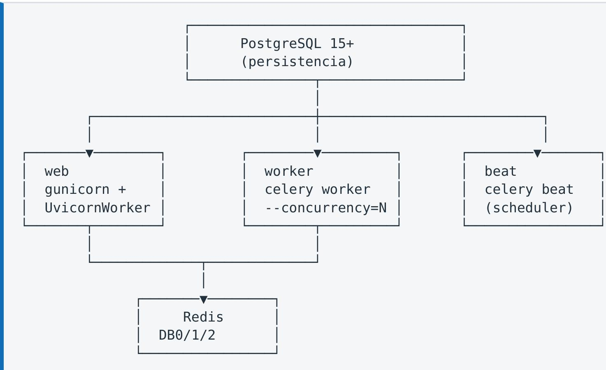

### 10. Configuración y despliegue

### 10.1 Variables de entorno

Gestionadas por Pydantic Settings v2 con validación en carga. El proceso falla al arrancar si falta una obligatoria, lo que impide desplegar con configuración incompleta.

<table><tr><td>Variable</td><td>Obligatoria</td><td>Default</td><td>Descripción</td></tr><tr><td>SECRET_KEY</td><td>Sí</td><td>—</td><td>Clave de firma JWT. Generar con openssl rand -hex 32</td></tr><tr><td>DATABASE_URL</td><td>Sí</td><td>—</td><td>Cadena de conexión PostgreSQL</td></tr><tr><td>REDIS_URL</td><td>No</td><td>redis://localhost:6379/0</td><td>Redis de aplicación</td></tr><tr><td>CELERY_BROKER_URL</td><td>No</td><td>redis://localhost:6379/1</td><td>Broker de Celery</td></tr><tr><td>CELERY_RESULT_BACKEND</td><td>No</td><td>redis://localhost:6379/2</td><td>Resultados de Celery</td></tr><tr><td>JWT_ALGORITHM</td><td>No</td><td>HS256</td><td>Algoritmo de firma</td></tr><tr><td>JWT_EXPIRATION_MINUTES</td><td>No</td><td>480</td><td>Duración de sesión (8 h)</td></tr><tr><td>APP_NAME</td><td>No</td><td>ITSM Kanban MVP</td><td>Nombre visible en la interfaz</td></tr><tr><td>DEBUG</td><td>No</td><td>false</td><td>Modo depuración</td></tr><tr><td>PUBLIC_BASE_URL</td><td>No</td><td>http://localhost:8000</td><td>URL pública</td></tr><tr><td>BOOTSTRAP_ADMIN_USERNAME</td><td>No</td><td>admin</td><td>Usuario inicial</td></tr><tr><td>BOOTSTRAP_ADMIN_PASSWORD</td><td>No</td><td>admin123</td><td>Cambiar en producción</td></tr><tr><td>BOOTSTRAP_ADMIN_EMAIL</td><td>No</td><td>admin@example.com</td><td>Correo inicial</td></tr></table>

Riesgo de configuración: BOOTSTRAP_ADMIN_PASSWORD tiene default admin123 y se aplica automáticamente en el primer arranque. Si se despliega sin sobrescribirla, existe una cuenta administrativa con credencial publicada en el repositorio.

### 10.2 Inicialización de base de datos

python -m app.db.init_db ejecuta una secuencia de pasos idempotentes (cada uno verifica si el recurso ya existe antes de crearlo):

<table><tr><td>Paso</td><td>Función</td><td>Resultado</td></tr><tr><td>1</td><td>_crear_tablas()</td><td>7 tablas vía create_all()</td></tr><tr><td>2</td><td>_seed_admin()</td><td>1 usuario administrador</td></tr><tr><td>3</td><td>_seed_estados()</td><td>6 estados del ciclo de vida</td></tr><tr><td>4</td><td>_seed_transiciones()</td><td>10 reglas de transición</td></tr><tr><td>5</td><td>_seed_sla()</td><td>4 políticas SLA</td></tr><tr><td>6</td><td>_seed_catalogos()</td><td>11 ítems de catálogo</td></tr><tr><td>7</td><td>_seed_tickets_ejemplo()</td><td>6 tickets, uno por estado</td></tr></table>

La idempotencia permite ejecutar el sembrado en cada arranque sin riesgo de duplicación —comportamiento construido en el hook lifespan de FastAPI, dentro de un try/except que registra pero no detiene el arranque.

### 10.3 Topología de despliegue

El módulo requiere cuatro procesos sobre infraestructura compartida:

Los tres procesos se lanzan con el mismo punto de entrada, que detecta su rol:

celery -A app.core.celery_app:celery_app worker --loglevel=info --concurrency=2
celery -A app.core.celery_app:celery_app beat --loglevel=info
uvicorn app.main:app --host 0.0.0.0 --port $PORT

Verificación de salud disponible en /health (texto) y /salud (JSON), útil como healthcheckPath en Railway, Fly.io o Kubernetes.

### 11. Pruebas automatizadas

4 pruebas unitarias sobre el servicio de negocio, todas en verde, ejecutadas sobre SQLite en memoria (StaticPool) para aislamiento completo y sin dependencias externas.

<table><tr><td>Prueba</td><td>Verifica</td></tr><tr><td>test_transicion_legal_admin</td><td>Un movimiento con regla existente y rol suficiente se ejecuta y genera exactamente un evento de auditoría con el actor_username correcto</td></tr><tr><td>test_transicion_legal</td><td>Saltarse una etapa del flujo (Pendiente → Cerrado sin regla) lanza HTTPException con código 422</td></tr><tr><td>test_comentario_requerido</td><td>Una transición con requiere_comentario=True falla sin comentario (422) y tiene éxito al proporcionarlo</td></tr><tr><td>test_auditoria_obligatoria</td><td>El recuento de eventos de auditoría se incrementa exactamente en uno por movimiento exitoso</td></tr></table>

## Características de la suite:

• Aislamiento: base SQLite en memoria creada y destruida por prueba (create_all / drop_all en fixture).

• Determinismo: el fixture siembra un estado mínimo conocido (3 estados, 2 transiciones, 1 ticket, 1 admin), sin dependencia del orden de ejecución.

• Cobertura focalizada: las pruebas apuntan a la lógica de negocio, no a la capa HTTP. No se prueba el renderizado de plantillas ni la integración con Celery.

Deficiencia reconocida: la suite no cubre el endpoint HTMX de extremo a extremo. El protocolo HX-Reswap / HX-Trigger, el fragmento devuelto y el flujo de reordenamiento dentro de la misma columna quedan sin verificar automáticamente. Una prueba con TestClient sobre el endpoint completo detectaría regresiones en el contrato entre backend y frontend.

### 12. Limitaciones técnicas

Esta sección documenta honestamente las restricciones del módulo en su estado actual. Cada una debe considerarse antes de la incorporación.

### 12.1 Limitaciones funcionales

<table><tr><td>#</td><td>Limitación</td><td>Impacto</td><td>Mitigación</td></tr><tr><td>L1</td><td>El tablero no captura el comentario obligatorio. tablero.html envía comentario: '' de forma fija. Toda transición con requiere_comentario=True (cerrar, cancelar, bloquear, devolver) siempre falla desde la interfaz</td><td>Alto</td><td>Implementar diálogo prompt() o modal antes del htmx.ajax, condicionando si la transición de destino lo exige</td></tr><tr><td>L2</td><td>La recarga en error recarga la página. El rechazo usa HX-Reswap: none correctamente, pero el setTimeout(location.reload, 1500) recarga la página completa</td><td>Medio</td><td>Eliminar el reload si la reversión visual del DOM es fiable</td></tr><tr><td>L3</td><td>Sin CRUD completo de tickets</td><td>Bajo</td><td>Solo alta y movimiento; falta edición, borrado, búsqueda y filtrado</td></tr><tr><td>L4</td><td>Sin adjuntos ni comentarios</td><td>Bajo</td><td>Los tipos de evento ADJUNTO_AGREGADO y COMENTARIO_AGREGADO están declarados pero no emitidos</td></tr><tr><td>L5</td><td>Sin notificaciones reales</td><td>Bajo</td><td>notificar cambio estado solo escribe en auditoría</td></tr><tr><td>L6</td><td>Sin i18n</td><td>Bajo</td><td>Interfaz íntegramente en español</td></tr></table>

### 12.2 Limitaciones técnicas

<table><tr><td>#</td><td>Limitación</td><td>Impacto</td></tr><tr><td>T1</td><td>Sin Alembic efectivo. alembic está en dependencias pero el esquema se crea con create_all(), que no altera tablas existentes</td><td>Cambios de esquema requieren recrear la base</td></tr><tr><td>T2</td><td>app/schemas/ está vacío. No hay modelos Pydantic de validación; los endpoints usan Form y diccionarios</td><td>Contratos de API no documentados automáticamente en OpenAPI</td></tr><tr><td>T3</td><td>_generar_codigo_ticket tiene condición de carrera. Lee max(id)+1 sin bloqueo</td><td>Dos altas concurrentes pueden colisionar; la restricción UNIQUE hace fallar la segunda</td></tr><tr><td>T4</td><td>Importaciones dinámicas con __import__() en auth.py:63 y init_db.py:160</td><td>Frágil ante refactorización; debería ser import directo</td></tr><tr><td>T5</td><td>cookie.secure hardcodeado en false</td><td>Inseguro bajo HTTPS</td></tr><tr><td>T6</td><td>La suite de pruebas tarda ~154 s. Celery intenta conectar a Redis y reintenta 20 veces por prueba</td><td>Requiere un fixture que desactive el broker en entorno de test</td></tr><tr><td>T7</td><td>app/static/js/ existe pero está vacío</td><td>Todo el JS se sirve por CDN; sin activos propios</td></tr><tr><td>T8</td><td>Dependencias de frontend por CDN sin integrity (SRI)</td><td>Riesgo de compromiso de cadena de suministro</td></tr></table>

### 12.3 Hoja de ruta de maduración

Ordenado por relación esfuerzo/beneficio:

1. Resolver L1 (captura de comentario) — desbloquea el flujo completo de cierre y cancelación

2. Añadir pruebas del endpoint HTMX — cierra el hueco de cobertura más importante

3. Introducir Alembic — requisito previo para cualquier evolución de esquema

4. Parametrizar cookie.secure y añadir rate limiting en login

5. Migrar import() a imports directos

6. Modelos Pydantic en app/schemas/ — validación y documentación automática

7. Notificaciones reales (SMTP/webhook) sobre la base ya existente

8. Internacionalización de plantillas