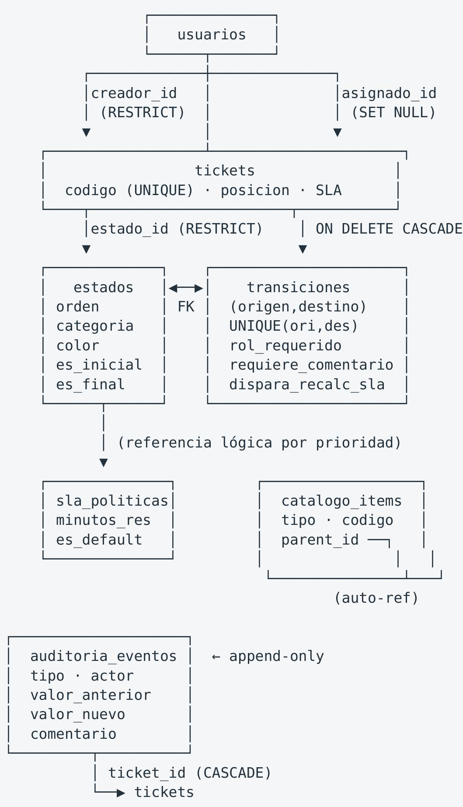

<table><tr><td>Columna</td><td>Tipo</td><td>Función</td></tr><tr><td>nombre</td><td>VARCHAR(64) UNIQUE</td><td>Identificador legible</td></tr><tr><td>orden</td><td>INTEGER</td><td>Posición izquierda → derecha en el tablero</td></tr><tr><td>categoria</td><td>ENUM(20)</td><td>Semántica funcional del estado</td></tr><tr><td>color</td><td>VARCHAR(7)</td><td>Color HEX de la cabecera de columna</td></tr><tr><td>es_inicial / es_final</td><td>BOOLEAN</td><td>Marcadores del ciclo de vida</td></tr></table>

Enum CategoriiaEstado — agrupa estados que comparten comportamiento aunque su nombre varíe:

<table><tr><td>Categoría</td><td>Significado</td></tr><tr><td>PENDIENTE</td><td>Backlog, trabajo no iniciado</td></tr><tr><td>EN_PROGRESO</td><td>Trabajo activo en curso</td></tr><tr><td>BLOQUEADO</td><td>En espera por dependencia externa</td></tr><tr><td>RESUELTO</td><td>Trabajo terminado, pendiente de verificación</td></tr><tr><td>CERRADO</td><td>Terminal. Ciclo de vida concluido</td></tr><tr><td>CANCELADO</td><td>Terminal. Desestimado</td></tr></table>

El campo es final tiene consecuencias funcionales reales: las tareas de Celery lo consultan para marcar el SLA como cumplido automáticamente (recalcular sla ticket línea 49) sin necesidad de esperar al vencimiento.

Tabla transiciones — el corazón del control ITSM

Esta tabla es la pieza que distingue este módulo de un Kanban convencional. Cada fila declara qué movimiento es legal.

<table><tr><td>Columna</td><td>Tipo</td><td>Función</td></tr><tr><td>origen_id</td><td>FK → estados.id ON DELETE CASCADE</td><td>Estado de partida</td></tr><tr><td>destino_id</td><td>FK → estados.id ON DELETE CASCADE</td><td>Estado de llegada</td></tr><tr><td>nombre</td><td>VARCHAR(64)</td><td>Etiqueta de la acción ("Iniciar", "Cerrar")</td></tr><tr><td>rol_requerido</td><td>ENUM(20)</td><td>Privilegio mínimo exigido</td></tr><tr><td>requiere_comentario</td><td>BOOLEAN</td><td>Si exige justificación escrita</td></tr><tr><td>dispara_recalculo_sla</td><td>BOOLEAN</td><td>Si debe encolar tarea asíncrona</td></tr><tr><td>activo</td><td>BOOLEAN</td><td>Interruptor para desactivar sin borrar</td></tr></table>

Restricción de unicidad: UNIQUE (origen_id, destino_id) garantiza que no existan reglas duplicadas ni ambiguas para el mismo par de estados. Esto es relevante porque mover_ticket() usa .first() para localizar la regla; sin la restricción, el comportamiento sería no determinista.

Matriz de transiciones sembrada por defecto (10 reglas):

<table><tr><td>Origen</td><td>→ Destino</td><td>Rol mínimo</td><td>Comentario</td><td>Nombre</td></tr><tr><td>Pendiente</td><td>En curso</td><td>AGENTE</td><td>No</td><td>Iniciar</td></tr><tr><td>Pendiente</td><td>Cancelado</td><td>AGENTE</td><td>Sí</td><td>Cancelar</td></tr><tr><td>En curso</td><td>Bloqueado</td><td>AGENTE</td><td>Sí</td><td>Bloquear</td></tr><tr><td>En curso</td><td>En revisión</td><td>AGENTE</td><td>No</td><td>Enviar a revisión</td></tr><tr><td>En curso</td><td>Pendiente</td><td>AGENTE</td><td>Sí</td><td>Devolver</td></tr><tr><td>Bloqueado</td><td>En curso</td><td>AGENTE</td><td>No</td><td>Desbloquear</td></tr><tr><td>Bloqueado</td><td>Cancelado</td><td>AGENTE_SENIOR</td><td>Sí</td><td>Cancelar (bloq.)</td></tr><tr><td>En revisión</td><td>En curso</td><td>AGENTE</td><td>Sí</td><td>Devolver a curso</td></tr><tr><td>En revisión</td><td>Cerrado</td><td>AGENTE_SENIOR</td><td>Sí</td><td>Cerrar</td></tr><tr><td>En revisión</td><td>Cancelado</td><td>AGENTE_SENIOR</td><td>Sí</td><td>Cancelar (rev.)</td></tr></table>

Lectura de negocio de la matriz: el flujo happy-path es Pendiente → En curso → En revisión → Cerrado. Cerrar y cancelar exigen siempre justificación escrita y privilegio AGENTE_SENIOR. Las flechas de retroceso (Devolver, Desbloquear) existen deliberadamente: un ITSM rígido que solo permite avanzar obliga a los técnicos a "hackear" el sistema. Aquí el retroceso es una transición de primera clase, auditada como cualquier otra.

Tabla tickets

<table><tr><td>Columna</td><td>Tipo</td><td>Notas</td></tr><tr><td>codigo</td><td>VARCHAR(32) UNIQUE INDEX</td><td>Identificador de negocio legible (TKT-00001)</td></tr><tr><td>titulo</td><td>VARCHAR(255) NOT NULL</td><td>Resumen en una línea</td></tr><tr><td>descripción</td><td>TEXT</td><td>Detalle libre</td></tr><tr><td>estado_id</td><td>FK → estados.id RESTRICT</td><td>La columna actual del Kanban</td></tr><tr><td>prioridad</td><td>ENUM(10)</td><td>BAJA · MEDIA · ALTA · CRITICA</td></tr><tr><td>creador_id</td><td>FK → usuarios.id RESTRICT</td><td>Quién reporta</td></tr><tr><td>asignado_id</td><td>FK → usuarios.id SET NULL</td><td>Quién atiende. NULL si desasignado</td></tr><tr><td>posición</td><td>INTEGER</td><td>Orden manual dentro de la columna</td></tr><tr><td>fecha_vencimiento_sla</td><td>TIMESTAMPTZ NULL</td><td>Calculado por Celery</td></tr><tr><td>sla_cumplido</td><td>BOOLEAN NULL</td><td>Ternario: NULL = sin calcular, TRUE = en plazo, FALSE = vencido</td></tr><tr><td>metadata_json</td><td>TEXT default '{}'</td><td>Extensibilidad sin migración</td></tr></table>

## Decisiones de integridad relevantes:

• estado_id usa ON DELETE RESTRICT: es imposible borrar un estado que tenga tickets asociados. Esto protege la integridad del historical.

• asignado_id usa ON DELETE SET NULL: desasignar un usuario no destruye tickets. Se prefiere perder la asignación antes que el registro.

• Índice compuesto ix tickets estado orden (estado id, posicion): está calibrado exactamente para la consulta del tablero, que siempre pide "los tickets de esta columna ordenados por posición". Sin este índice, cada renderizado del Kanban degrada a un escaneo secuencial conforme crece el histórico.

El ternario de sla_cumplido merece atención: NULL no significa "cumplió", significa "aún no se ha calculado". Esta distinción entre "no sabemos" y "sabemos que no cumplió" es fundamental en la gestión de SLA y se refleja directamente en la interfaz, donde la tarjeta muestra tres estados visuales distintos: *Sin calcular* (gris), *En plazo* (verde), *Vencido* (rojo).

### 4.3 Capa de trazabilidad y soporte

Tabla auditoria_eventos — registro append-only

<table><tr><td>Columna</td><td>Tipo</td><td>función</td></tr><tr><td>ticket_id</td><td>FK → tickets.id ON DELETE CASCADE</td><td>Ticket afectado</td></tr><tr><td>tipo</td><td>ENUM(30) INDEX</td><td>Naturaleza del evento</td></tr><tr><td>actor_id</td><td>FK → usuarios.id SET NULL</td><td>Autor (NULL si fue un proceso automático)</td></tr><tr><td>actor_username</td><td>VARCHAR(64)</td><td>Desnormalizado deliberadamente</td></tr><tr><td>valor_anterior</td><td>TEXT</td><td>Estado previo, JSON serializado</td></tr><tr><td>valor_nuevo</td><td>TEXT</td><td>Estado nuevo, JSON serializado</td></tr><tr><td>comentario</td><td>TEXT</td><td>Justificación escrita</td></tr><tr><td>created_at</td><td>TIMESTAMPTZ INDEX</td><td>Marca temporal</td></tr></table>

Enum TipoEvento — taxonomía de 8 eventos auditables:

<table><tr><td>Evento</td><td>Cuándo se emite</td></tr><tr><td>CREADO</td><td>Alta del ticket</td></tr><tr><td>ESTADO_CAMBIADO</td><td>Movimiento validado en el Kanban</td></tr><tr><td>REASIGNADO</td><td>Cambio de responsable</td></tr><tr><td>PRIORIDAD_CAMBIADA</td><td>Reclasificación por severidad</td></tr><tr><td>COMENTARIO_AGREGADO</td><td>Interacción del usuario</td></tr><tr><td>ADJUNTO_AGREGADO</td><td>Carga de evidencia</td></tr><tr><td>SLA_CALCULADO</td><td>Tarea Celery recalcula el plazo</td></tr><tr><td>NOTIFICACION_ENVIADA</td><td>Proceso automático notifica</td></tr></table>

Por qué actor_username está desnormalizado. Es una decisión deliberada que merece justificación explícita. Cuando un usuario se elimina de la tabla usuarios (actor_id pasa a NULL por ON DELETE SET NULL), el registro de auditoría conserva el nombre de quien actuó. En una auditoría de cumplimiento, «el usuario #47 movió este ticket» es inservible dos años después si #47 ya no existe. La desnormalización compra integridad del registro a costa de una anomalía de actualización controlada, y es el compromiso correcto para tablas append-only.

Modelo strictly append-only. El modelo declara sus campos sin updated_at y su relación con cascada all, delete-orphan, lo que impide actualizaciones accidentales desde la capa de aplicación. No existe endpoint que modifique o elimine un evento.

Tabla sla\_políticas

<table><tr><td>Columna</td><td>Tipo</td><td>función</td></tr><tr><td>nombre</td><td>VARCHAR(64) UNIQUE</td><td>Identificador de la política</td></tr><tr><td>prioridad</td><td>ENUM(10) INDEX</td><td>Prioridad a la que aplica</td></tr><tr><td>minutos_resolución</td><td>INTEGER</td><td>Plazo máximo en minutos</td></tr><tr><td>es_default</td><td>BOOLEAN</td><td>Política activa para esa prioridad</td></tr><tr><td>activo</td><td>BOOLEAN</td><td>Interruptor</td></tr></table>

Políticas sembradas:

<table><tr><td>Política</td><td>Prioridad</td><td>Plazo</td></tr><tr><td>SLA Crítica</td><td>CRITICA</td><td>4 horas</td></tr><tr><td>SLA Alta</td><td>ALTA</td><td>24 horas</td></tr><tr><td>SLA Media</td><td>MEDIA</td><td>72 horas</td></tr><tr><td>SLA Baja</td><td>BAJA</td><td>168 horas (7 días)</td></tr></table>

El flag es default permite mantener múltiples políticas por prioridad (por ejemplo, por cliente o por contrato) y seleccionar cuál aplica sin duplicar código.

Tabla catalogo_items — base para mantenedores futuros

Tabla única que hospeda todos los catálogos del sistema, discriminados por la columna tipo. Este diseño evita crear una tabla nueva por cada concepto configurable.

<table><tr><td>Campo</td><td>Función</td></tr><tr><td>tipo</td><td>TIPO_TICKET · CATEGORIA · ETIQUETA · MODULO</td></tr><tr><td>codigo</td><td>Código corto de negocio (INC, HW, AUTH)</td></tr><tr><td>nombre / descripción</td><td>Etiqueta visible y glosa</td></tr><tr><td>color</td><td>Color HEX para representación visual</td></tr><tr><td>parent_id</td><td>FK autorreferenciada para jerarquías</td></tr><tr><td>orden</td><td>Posición en el mantenedor</td></tr></table>

Restricción: UNIQUE (tipo, codigo) — el mismo código puede repetirse en catálogos distintos (un HW de categoría y un HW de módulo coexisten sin conflicto).

Auto-referencia. parent_id con ON DELETE SET NULL habilita árboles de jerarquía arbitrariamente profundos (Categoría → Subcategoría → Sub-subcategoría). El campo activo en toda la tabla —presente en esta misma tabla — permite desactivar ítems sin borrarlos, preservando la integridad referencial de tickets históricos que los Marcaban.

Catálogos sembrados (11 ítems): 4 tipos de ticket (Incidencia, Requerimiento, Bug, Consulta), 4 categorías (Hardware, Software, Redes, Seguridad), 3 módulos (Autenticación, API, Interfaz).

### 4.4 Diagrama entidad-relación

